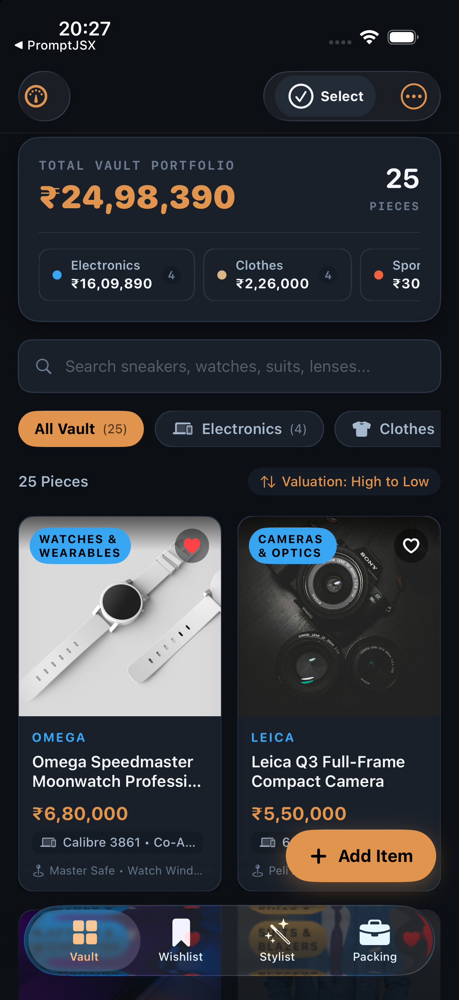
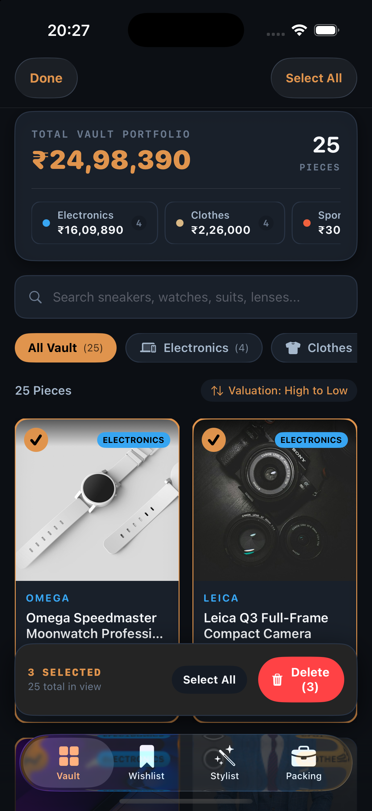
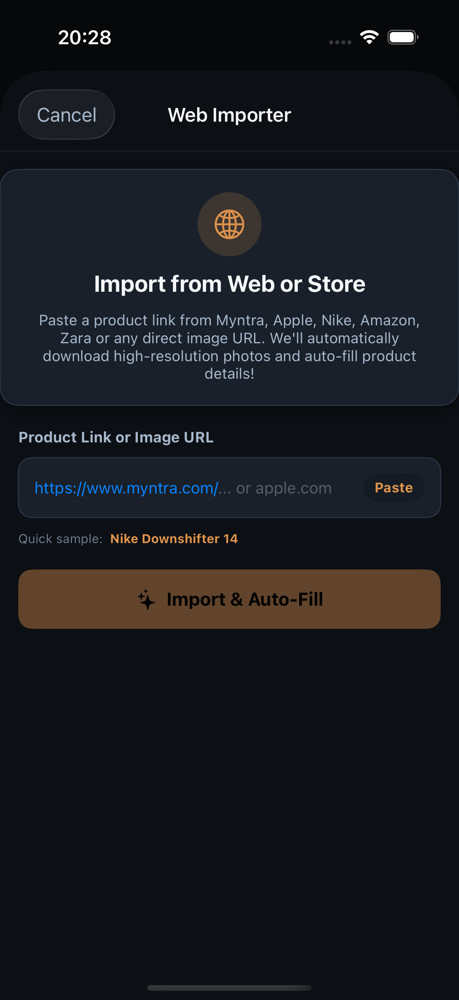
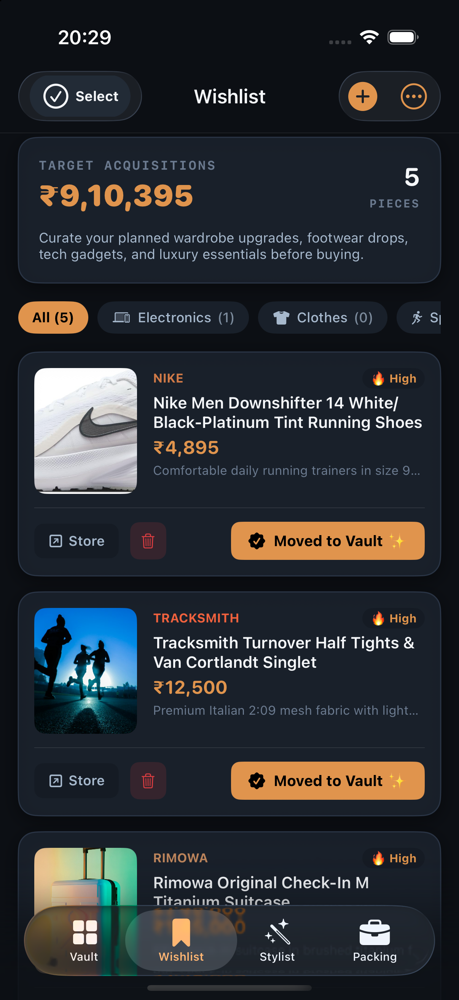
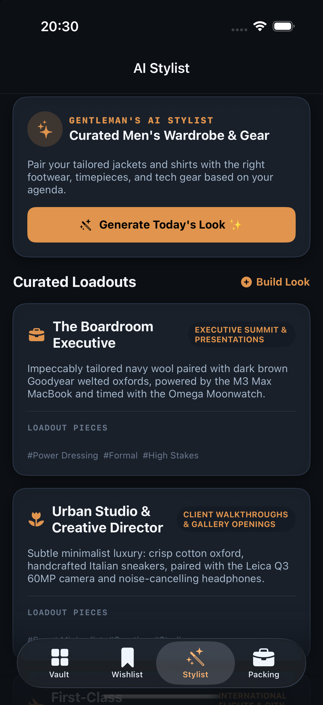
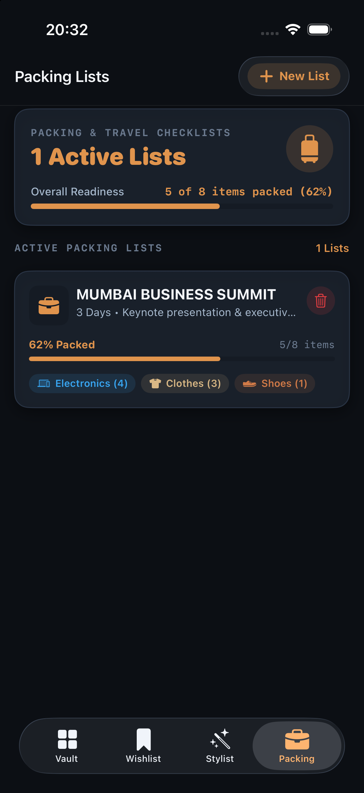

# Cockpit — Men's Executive Wardrobe & EDC Dashboard for iOS

<p align="center">
  
</p>

A native, high-performance iOS application crafted in SwiftUI for modern gentlemen to curate, value, organize, and coordinate their wardrobe, luxury mechanical timepieces, footwear, tech EDC, and travel gear.

Built with an obsidian, brushed titanium, and cognac gold aesthetic inspired by aeronautical cockpit instrumentation and haute horlogerie.

---

## 📱 Visual Showcase & Screenshots

| **01. Executive Vault Portfolio** | **02. Multi-Select & Batch Actions** |
|:---:|:---:|
|  |  |
| *Real-time valuation metrics, 7 category filters, search, and constrained 2-column grid.* | *Luxury gold checkmark selection mode with floating bulk deletion confirmation.* |

| **03. Automated Web Importer** | **04. Target Wishlist & Valuation** |
|:---:|:---:|
|  |  |
| *Instant 1-tap scraper with ASIN resolution, CDN photo preservation, & duplicate detection.* | *Track aspirational acquisitions, target pricing, priority tiers, and 1-tap vault promotion.* |

| **05. AI Stylist & Outfits** | **06. Packing & Travel Director** |
|:---:|:---:|
|  |  |
| *Occasion-based recommendations across Black Tie, Sartorial Casual, and Active Training.* | *Dedicated travel expeditions directory with packing meters and item checklists.* |

---

## ✨ Key Features

### 1. 7 Tailored Luxury Categories
- 👔 **Clothes**: Bespoke tailoring, Italian blazers, Oxford shirts, selvedge denim, knitwear, and outerwear.
- 👞 **Shoes**: Goodyear-welted oxfords, horsebit loafers, Chelsea boots, and designer sneakers.
- 🏃‍♂️ **Sports Wear**: Gym & athletic wear, technical training kits, running apparel, and outdoor gear.
- ⌚️ **Electronics & Horology**: Mechanical timepieces, Leica optics, titanium computing, and audiophile acoustics.
- 💼 **Bags & Luggage**: Aluminum carry-on cases, full-grain leather briefcases, and weekender duffels.
- 🧴 **Grooming & Fragrances**: Haute parfumerie, artisanal shaving sets, and premium skincare.
- 🕶️ **Accessories**: Wallets, leather belts, Japanese eyewear, cufflinks, and fine everyday carry.

### 2. Multi-Select & Bulk Deletion
- **Selection Mode**: Activate multi-select via the top-right menu with gold circular checkmark badges and border highlights.
- **Select All / Deselect All**: 1-tap toggle to mass-select any filtered category or view.
- **Floating Batch Action Bar**: Glassmorphic bottom bar displaying selection counts and destructive bulk deletion with an explicit confirmation dialog.

### 3. Duplicate Prevention & Cleaner
- **Import Deduplication**: Automatically cross-references incoming product names, brands, and URLs against your existing vault and wishlist. Matches update existing pieces with new photos and metadata rather than cluttering your inventory.
- **1-Tap Cleanup**: Run "Remove Duplicates" from the action menu anytime to scan and prune redundant entries.

### 4. Direct Web & Store Importer
- Import product specifications, prices, brands, and CDN master images directly from Amazon, Myntra, or arbitrary web product links.
- Handles ASIN canonicalization and anti-bot headers for high-fidelity extraction.
- Resilient image loading with caching and local document persistence.

### 5. Pixel-Perfect Grid Stability
- Engineered with strict image frame proposals and aspect clipping to prevent large remote product images from breaking out of SwiftUI's `LazyVGrid` columns.

### 6. Expedition & Packing Director
- Clean directory of upcoming trips (e.g., Tokyo Flight, European Summit).
- Category-by-category checklists with instant item removal, completion progress rings, and list deletion.

---

## 🛠️ Architecture & Tech Stack

- **Platform**: iOS 17.0+
- **Language**: Swift 5.10
- **Framework**: SwiftUI (100% Native, zero third-party dependencies)
- **Architecture**: MVVM with reactive `@Published` observable data pipeline
- **Theme**: Luxury Cockpit Obsidian (`#0F0F12`), Cognac Amber (`#D4AF37`), Carbon Slate (`#1A1A22`)
- **Persistence**: FileSystem JSON storage with sandboxed local image caching

---

## 🚀 Getting Started

### Prerequisites
- macOS Sonoma or later
- Xcode 15.0+ with iOS 17 SDK installed
- Connected iPhone running iOS 17+ or Xcode Simulator

### Setup & Installation

1. **Clone the repository**:
   ```bash
   git clone https://github.com/Amara-Manikanta/Cockpit-Men-s-Dashboard.git
   cd Cockpit-Men-s-Dashboard
   ```

2. **Open in Xcode**:
   ```bash
   open AtelierMen.xcodeproj
   ```

3. **Run on Device or Simulator**:
   - In Xcode, select your physical iPhone (e.g., *iPhone 14 Pro*) or a simulator from the device dropdown.
   - Press `Cmd + R` to build and deploy.

---

## 📄 License
Personal executive portfolio and dashboard. All rights reserved.
